# ARGOS — Base de datos (vista consolidada)

> Este documento reúne en un solo lugar el modelo completo. El detalle de cada tabla
> (todas las columnas, tipos y restricciones) vive en el plan de la fase que la crea;
> aquí se indica dónde está cada una y cómo se relacionan. Si hay diferencia entre este
> documento y un `fase0N.md`, manda el `fase0N.md` y hay que corregir aquí.

## 1. Principios

1. **PostgreSQL 16**, un solo clúster y una sola base de datos por ambiente.
2. **Schema `shared`** para todo lo global (tenants, usuarios, membresías, roles, tokens,
   jobs, facturación, claves API, bitácora de plataforma).
3. **Un schema por tenant** (`tenant_<slug>`) con exactamente las mismas tablas, creado
   y migrado en el alta del tenant. Un schema `tenant_template` siempre migrado a head
   se usa para autogenerar migraciones.
4. Las tablas de tenant **nunca llevan `tenant_id`**: el aislamiento lo da el schema. El
   backend fija `SET LOCAL search_path TO "<tenant>", "shared"` en cada transacción.
5. Las tablas de tenant sí pueden referenciar `shared.users(id)` por FK (Postgres permite
   FK entre schemas). Nunca al revés.
6. Convenciones: `id uuid PK default gen_random_uuid()`, `created_at` y `updated_at`
   `timestamptz default now()`; nombres en inglés, snake_case, plural; enumeraciones en
   `varchar` + `CHECK`; borrado lógico (`deleted_at`) solo en propiedades y archivos;
   tablas de eventos y bitácoras solo admiten `INSERT`.
7. Extensiones requeridas: `btree_gist` (exclusiones de solapamiento), `citext` (correo
   sin distinguir mayúsculas). `gen_random_uuid()` es nativo desde Postgres 13.
8. Nombres de constraints e índices según la convención de `BACKEND/migrations/README.md`
   (`pk_`, `fk_`, `uq_`, `ck_`, `ix_`), la misma que generaba Alembic.

## 2. Migraciones: qué crea cada una

| Entorno | Revisión | Crea o modifica | Fase |
| --- | --- | --- | --- |
| shared | `0001_initial` (existente) | `tenants`, `users` | — |
| shared | `0002_identity` | modifica `tenants` y `users`; crea `roles`, `role_permissions`, `memberships`, `refresh_tokens`, `one_time_tokens`, `invitations`, `device_tokens`, `jobs`, `platform_audit_log`; migra datos | 1 |
| shared | `0003_billing` | `plans`, `subscriptions`, `invoices`, `payments`, `payment_events`, `api_keys` | 6 |
| tenant | `0001_tenant_base` | `files`, `audit_log` | 1 |
| tenant | `0002_properties` (A) | `buildings`, `properties`, `property_owners`, `property_assignments`, `employees`, `employee_schedules`, `checklist_templates`, `checklist_template_items` | 2 |
| tenant | `0003_tasks_inventory` (B) | `tasks`, `task_checklist_items`, `task_events`, `task_consumptions`, `warehouses`, `inventory_items`, `inventory_stock`, `inventory_movements`, `employee_custody`, `inventory_discrepancies`, `restock_requests` | 2 |
| tenant | `0004_maintenance` (A) | `vendors`, `assets`, `maintenance_plans`, `maintenance_tickets`, `ticket_events`, `alerts` | 3 |
| tenant | `0005_notifications` (B) | `notifications`, `notification_preferences` | 3 |
| tenant | `0006_reservations` (A) | `booking_channels`, `property_ical_feeds`, `guests`, `reservations`, `reservation_guests`, `reservation_events`, `deposit_transactions`, `inspections`, `inspection_findings`; agrega FK `tasks.reservation_id` y `maintenance_tickets.reported_by_guest_id` | 4 |
| tenant | `0007_guest_parking_areas` (B) | `guest_access_tokens`, `security_alarms`, `parking_spots`, `parking_assignments`, `shared_areas`, `shared_area_bookings` | 4 |
| tenant | `0008_payroll` (A) | `payroll_settings`, `payroll_periods`, `payroll_entries`, `disciplinary_actions` | 5 |
| tenant | `0009_attendance_metrics` (B) | `attendance_records`, `performance_snapshots`, `goals`, `incentive_awards` | 5 |
| tenant | `0010_chat_locks` (B) | `conversations`, `conversation_participants`, `messages`, `lock_devices`, `lock_access_codes` | 6 |

(A) y (B) indican la persona dueña según [reparto.md](reparto.md). Las migraciones se
aplican por número; la de B en cada fase lleva el número siguiente a la de A de la misma
fase.

Orden de aplicación en cada despliegue: `argos migrate up` aplica `shared` y luego
`tenant` en todos los schemas. Formato y comandos en [fase01.md §3.1](fase01.md) y en
`BACKEND/migrations/README.md`.

## 3. Schema `shared`

| Tabla | Propósito | Claves y columnas principales | Detalle |
| --- | --- | --- | --- |
| `tenants` | Catálogo de empresas | `slug` uq, `schema_name` uq, `is_active`, `timezone`, `currency`, `logo_key`, `features` jsonb, `settings` jsonb, `require_2fa_roles` | fase01 §3.3 |
| `users` | Personas con contraseña (no huéspedes) | `email` uq (citext), `hashed_password` null, `full_name`, `phone`, `is_active`, `is_platform_admin`, `totp_secret` cifrado, `totp_enabled`, `last_login_at` | fase01 §3.3 |
| `roles` | Roles por tenant | `tenant_id` FK, `key`, `name`, `is_system`, `permissions_version`; uq `(tenant_id, key)` | fase01 §3.3 |
| `role_permissions` | Permisos de cada rol | PK `(role_id, permission)` | fase01 §3.3 |
| `memberships` | Usuario ↔ tenant ↔ rol | `user_id`, `tenant_id`, `role_id`, `status` (invited/active/suspended); uq `(user_id, tenant_id)` | fase01 §3.3 |
| `refresh_tokens` | Sesiones por dispositivo | `user_id`, `token_hash` uq, `family_id`, `device_id`, `platform`, `expires_at`, `revoked_at` | fase01 §3.3 |
| `one_time_tokens` | Reset, invitación, verificación | `user_id` null, `purpose`, `token_hash` uq, `payload`, `expires_at`, `used_at` | fase01 §3.3 |
| `invitations` | Invitaciones a un tenant | `tenant_id`, `email`, `role_id`, `token_id`, `status`; uq parcial pendientes | fase01 §3.3 |
| `device_tokens` | Tokens FCM | `user_id`, `fcm_token` uq, `platform` | fase01 §3.3 |
| `jobs` | Cola de trabajos | `tenant_id` null, `type`, `payload`, `status`, `scheduled_at`, `attempts`, `locked_at`, `locked_by`, `dedupe_key` uq parcial; ix `(status, scheduled_at)` | fase01 §3.3 |
| `platform_audit_log` | Bitácora de plataforma | `actor_user_id`, `tenant_id`, `action`, `entity`, `entity_id`, `metadata`; solo INSERT | fase01 §3.3 |
| `plans` | Planes comerciales | `key` uq, precios, `limits` jsonb | fase06 §3.1 |
| `subscriptions` | Suscripción por tenant | `tenant_id` uq, `plan_id`, `status`, período, `grace_days`, ids del proveedor | fase06 §3.1 |
| `invoices`, `payments`, `payment_events` | Facturas, pagos y webhooks | `number` uq; `event_id` uq | fase06 §3.1 |
| `api_keys` | Claves para integraciones | `tenant_id`, `key_hash` uq, `scopes`, `revoked_at` | fase06 §4.1 |

## 4. Schema de tenant, por módulo

### 4.1 Transversal (fase 1)

| Tabla | Propósito | Claves |
| --- | --- | --- |
| `files` | Todo archivo en S3 | `s3_key` uq con prefijo `tenants/{tenant_id}/`, `module`, `kind`, `entity_type`+`entity_id`, `status` (pending/ready/deleted), `expires_at` para retención |
| `audit_log` | Bitácora del tenant | `actor_user_id`/`actor_guest_id`, `action`, `entity`, `entity_id`, `property_id`, `before`, `after`; solo INSERT |

### 4.2 Propiedades y personal (fase 2)

| Tabla | Propósito | Relaciones |
| --- | --- | --- |
| `buildings` | Edificios | — |
| `properties` | Unidades | `building_id`, `checklist_template_id`; `access_info` cifrado; `code` uq; `deleted_at` |
| `property_owners` | Alcance del rol owner | PK `(property_id, user_id)` |
| `property_assignments` | Alcance de cleaner/maintenance | PK `(property_id, user_id)` |
| `employees` | Perfil laboral | `user_id` uq, `employee_code` uq, `pay_type`, `pay_rate`, `on_payroll` |
| `employee_schedules` | Horario semanal | `employee_id`, `weekday` |
| `checklist_templates`, `checklist_template_items` | Plantillas por propiedad | items con `section`, `position`, `requires_photo`, `requires_before_after` |

### 4.3 Itinerario y tareas (fase 2)

| Tabla | Propósito | Relaciones |
| --- | --- | --- |
| `tasks` | Tarea programada | `property_id`, `assigned_to`, `reservation_id` (FK en fase 4), `maintenance_ticket_id` (fase 3), `status`, `scheduled_date`, ventana, GPS inicio/fin, `is_late` |
| `task_checklist_items` | Snapshot del checklist | `task_id`; fotos por `files(entity_type='task_checklist_item')` |
| `task_events` | Línea de tiempo | `task_id`, `type`, `actor_user_id`; solo INSERT |
| `task_consumptions` | Insumos usados | `task_id`, `item_id`, `quantity` |

### 4.4 Inventario (fase 2)

| Tabla | Propósito | Relaciones |
| --- | --- | --- |
| `warehouses` | Bodega central (`property_id` null) o por propiedad | uq parcial `property_id` |
| `inventory_items` | Catálogo | `category` (consumable/tool/key), `min_stock` |
| `inventory_stock` | Existencias | PK `(warehouse_id, item_id)`, `quantity >= 0` |
| `inventory_movements` | Libro de movimientos inmutable | `type`, `from/to_warehouse_id`, `employee_user_id`, `task_id` |
| `employee_custody` | Lo que tiene cada colaborador | PK `(user_id, item_id)` |
| `inventory_discrepancies` | Diferencias al devolver | `user_id`, `item_id`, `task_id`, `status` |
| `restock_requests` | Solicitudes de reposición | `item_id`, `warehouse_id`, `status` |

### 4.5 Mantenimiento y notificaciones (fase 3)

| Tabla | Propósito | Relaciones |
| --- | --- | --- |
| `vendors` | Proveedores externos | — |
| `assets` | Activos por propiedad o edificio | `property_id`/`building_id` (uno obligatorio), `vendor_id`, `status`; documentos por `files` |
| `maintenance_plans` | Preventivos | `asset_id`, `frequency_days`, `next_due_at`, `responsible_user_id`/`vendor_id` |
| `maintenance_tickets` | Incidencias | `property_id`, `asset_id`, `plan_id`, `reported_by_user_id`/`reported_by_guest_id`, `assigned_to`, `vendor_id`, `task_id` |
| `ticket_events` | Línea de tiempo | solo INSERT |
| `notifications` | Bandeja por usuario o huésped | `recipient_user_id`/`recipient_guest_id`, `type`, `channels`, `read_at` |
| `notification_preferences` | Opt-out por tipo | PK `(user_id, type)` |
| `alerts` | Panel de alertas | `type`, `severity`, `entity_type`+`entity_id`, `status`; uq parcial activa por entidad |

### 4.6 Reservas y hospitalidad (fase 4)

| Tabla | Propósito | Relaciones |
| --- | --- | --- |
| `booking_channels` | Canales de venta | `kind`, `requires_deposit`, `has_checkin` |
| `property_ical_feeds` | URLs iCal por propiedad y canal | uq `(property_id, channel_id)` |
| `guests` | Huéspedes | uq `(document_type, document_number)`; fotos de documento en `files` con `expires_at` |
| `reservations` | Reserva | `property_id`, `channel_id`, `primary_guest_id`, `code` uq, `status`, fechas, depósito; EXCLUDE de solapamiento por propiedad |
| `reservation_guests` | Acompañantes | PK `(reservation_id, guest_id)` |
| `reservation_events` | Línea de tiempo | solo INSERT |
| `deposit_transactions` | Recibido / devuelto / retenido | `reservation_id`; inmutable |
| `inspections`, `inspection_findings` | Antes/después y hallazgos | `reservation_id`, `task_id`; `ticket_id` en hallazgo |
| `guest_access_tokens` | Acceso del huésped a la app | `reservation_id`, `guest_id`, `token_hash` uq, `expires_at` |
| `parking_spots`, `parking_assignments` | Parqueos | EXCLUDE de solapamiento por espacio |
| `shared_areas`, `shared_area_bookings` | Áreas comunes | capacidad validada en service con bloqueo de fila |
| `security_alarms` | Alarmas de check-in/out | `reservation_id`, `fire_at`, `status`, `attended_by` |

### 4.7 RRHH y métricas (fase 5)

| Tabla | Propósito | Relaciones |
| --- | --- | --- |
| `attendance_records` | Marcajes | `employee_id`; un abierto por empleado (uq parcial) |
| `payroll_settings` | Tasas y parámetros | una fila |
| `payroll_periods` | Períodos | `status` draft/review/closed; EXCLUDE solapamiento por `kind` |
| `payroll_entries` | Una fila por colaborador y período | uq `(period_id, employee_id)`; snapshot de esquema; montos |
| `disciplinary_actions` | Llamadas de atención y suspensiones | `employee_id`, `issued_by`, `acknowledged_at`; adjuntos por `files` |
| `performance_snapshots` | Métricas diarias materializadas | uq `(employee_id, date)` |
| `goals`, `incentive_awards` | Metas e incentivos | award → `payroll_entry_id` |

### 4.8 Chat e integraciones (fase 6)

| Tabla | Propósito | Relaciones |
| --- | --- | --- |
| `conversations` | Interna o de huésped | `reservation_id` si `kind='guest'` |
| `conversation_participants` | Miembros | uq parciales por `user_id` y `guest_id` |
| `messages` | Mensajes | `conversation_id`, `file_id`; ix `(conversation_id, created_at)` |
| `lock_devices`, `lock_access_codes` | Cerraduras Nexxt | `property_id`; `reservation_id`; credenciales y códigos cifrados |

## 5. Diagrama de relaciones principales

```mermaid
erDiagram
    TENANTS ||--o{ ROLES : "define"
    TENANTS ||--o{ MEMBERSHIPS : "tiene"
    USERS ||--o{ MEMBERSHIPS : "pertenece"
    ROLES ||--o{ MEMBERSHIPS : "asigna"
    ROLES ||--o{ ROLE_PERMISSIONS : "agrupa"
    USERS ||--o{ REFRESH_TOKENS : "sesiones"

    BUILDINGS ||--o{ PROPERTIES : "agrupa"
    PROPERTIES ||--o{ PROPERTY_ASSIGNMENTS : "asignada a"
    PROPERTIES ||--o{ PROPERTY_OWNERS : "propiedad de"
    USERS ||--o{ PROPERTY_ASSIGNMENTS : ""
    USERS ||--o| EMPLOYEES : "perfil"
    CHECKLIST_TEMPLATES ||--o{ CHECKLIST_TEMPLATE_ITEMS : ""
    PROPERTIES }o--o| CHECKLIST_TEMPLATES : "usa"

    PROPERTIES ||--o{ TASKS : ""
    USERS ||--o{ TASKS : "asignado"
    TASKS ||--o{ TASK_CHECKLIST_ITEMS : ""
    TASKS ||--o{ TASK_EVENTS : ""
    TASKS ||--o{ TASK_CONSUMPTIONS : ""
    FILES }o--o| TASK_CHECKLIST_ITEMS : "evidencia"

    WAREHOUSES ||--o{ INVENTORY_STOCK : ""
    INVENTORY_ITEMS ||--o{ INVENTORY_STOCK : ""
    INVENTORY_ITEMS ||--o{ INVENTORY_MOVEMENTS : ""
    USERS ||--o{ EMPLOYEE_CUSTODY : ""
    USERS ||--o{ INVENTORY_DISCREPANCIES : ""

    PROPERTIES ||--o{ ASSETS : ""
    ASSETS ||--o{ MAINTENANCE_PLANS : ""
    ASSETS ||--o{ MAINTENANCE_TICKETS : ""
    MAINTENANCE_TICKETS |o--o| TASKS : "genera"
    VENDORS ||--o{ ASSETS : ""

    BOOKING_CHANNELS ||--o{ RESERVATIONS : ""
    PROPERTIES ||--o{ RESERVATIONS : ""
    GUESTS ||--o{ RESERVATION_GUESTS : ""
    RESERVATIONS ||--o{ RESERVATION_GUESTS : ""
    RESERVATIONS ||--o{ DEPOSIT_TRANSACTIONS : ""
    RESERVATIONS ||--o{ INSPECTIONS : ""
    INSPECTIONS ||--o{ INSPECTION_FINDINGS : ""
    RESERVATIONS ||--o{ GUEST_ACCESS_TOKENS : ""
    RESERVATIONS ||--o{ PARKING_ASSIGNMENTS : ""
    PARKING_SPOTS ||--o{ PARKING_ASSIGNMENTS : ""
    SHARED_AREAS ||--o{ SHARED_AREA_BOOKINGS : ""
    RESERVATIONS ||--o{ SHARED_AREA_BOOKINGS : ""
    RESERVATIONS ||--o{ SECURITY_ALARMS : ""
    RESERVATIONS ||--o{ TASKS : "limpieza de salida"

    EMPLOYEES ||--o{ ATTENDANCE_RECORDS : ""
    PAYROLL_PERIODS ||--o{ PAYROLL_ENTRIES : ""
    EMPLOYEES ||--o{ PAYROLL_ENTRIES : ""
    EMPLOYEES ||--o{ DISCIPLINARY_ACTIONS : ""
    GOALS ||--o{ INCENTIVE_AWARDS : ""

    CONVERSATIONS ||--o{ CONVERSATION_PARTICIPANTS : ""
    CONVERSATIONS ||--o{ MESSAGES : ""
    RESERVATIONS |o--o| CONVERSATIONS : "chat de huésped"
```

## 6. Reglas de aislamiento que la BD respalda

| Regla | Mecanismo |
| --- | --- |
| Un tenant no ve a otro | Schema separado + `SET LOCAL search_path` por transacción; el usuario de BD de la aplicación no tiene `search_path` global a ningún tenant |
| Un rol no ve lo que no le toca | Permisos en `shared.role_permissions` verificados por endpoint; alcance por `property_assignments`, `property_owners`, `guest_access_tokens` aplicado en cada consulta |
| Archivos | `files.s3_key` siempre bajo `tenants/{tenant_id}/`; el backend valida el prefijo antes de firmar |
| Bitácoras inmutables | `REVOKE UPDATE, DELETE` sobre `audit_log`, `platform_audit_log`, `*_events`, `inventory_movements`, `deposit_transactions` para el rol de la aplicación |
| Documentos de identidad | `files.expires_at = check_out + 90 días`; job diario borra S3 y marca `deleted` |
| Solapamientos imposibles | `EXCLUDE USING gist` en reservas, parqueos y períodos de nómina |

## 7. Retención

| Dato | Retención | Mecanismo |
| --- | --- | --- |
| Fotos de DPI/pasaporte | 90 días tras check-out | `files.expires_at` + job `retention_cleanup` |
| Evidencias de limpieza e inspección | 24 meses | ídem |
| `files.status='pending'` | 24 h | job `storage_cleanup` |
| Notificaciones leídas | 180 días | job |
| `jobs` en `done` | 30 días | job |
| Bitácoras | permanente | — |
| Refresh tokens vencidos o revocados | 30 días después | job |

## 8. Índices y rendimiento

* Toda FK tiene índice.
* Listados principales indexados por lo que filtra la interfaz: tareas por
  `(assigned_to, scheduled_date)` y `(property_id, scheduled_date)`; reservas por
  `(property_id, check_in_date)` y `check_out_date`; notificaciones por
  `(recipient_user_id, read_at, created_at)`; mensajes por `(conversation_id, created_at)`.
* Paginación por cursor (`created_at, id`) en todos los listados; nunca `OFFSET` grande.
* `jobs`: índice `(status, scheduled_at)` y `SKIP LOCKED`.
* Los jsonb (`features`, `settings`, `data`, `payload`) no se indexan salvo necesidad
  comprobada.

## 9. Semillas (seeds)

* `argos seed platform-admin`: crea el primer usuario de plataforma (ya existe).
* `argos seed demo-tenant`: crea tenant `demo` con un usuario por rol, dos edificios,
  seis propiedades con plantilla, inventario básico, tareas de la semana, dos activos con
  preventivo, tres reservas (una por canal), un área común y dos parqueos. Es el dataset
  de las pruebas manuales de app y web.
* Roles por defecto: se siembran desde `internal/modules/authz/default_roles.go` al crear
  cualquier tenant.
